  

---

### 🧭 What I work on

<table>
  <tr>
    <td width="50%" valign="top">
      <h4>🤖 AI Agent System Design</h4>
      Task decomposition, tool use, context &amp; memory, workflow orchestration and result validation.
    </td>
    <td width="50%" valign="top">
      <h4>🧠 LLM Training &amp; Fine-tuning</h4>
      Data construction, training strategies and task-specific adaptation for practical applications.
    </td>
  </tr>
  <tr>
    <td width="50%" valign="top">
      <h4>⚙️ Architecture Optimization</h4>
      Model structure, inference efficiency and deployment compatibility for stable, efficient systems.
    </td>
    <td width="50%" valign="top">
      <h4>🚀 Deployment &amp; Runtime</h4>
      Compression, quantization, ONNX / TensorRT acceleration, serving and edge devices.
    </td>
  </tr>
</table>

### 🛠️ Tech stack

  
  
  
  
  
  
  

### 🌍 Open source contributions

<table align="center">
  <tr>
    <td align="center" width="140"><a href="https://github.com/sgl-project/sglang/pulls?q=is%3Apr+author%3AGCSimba"> <b>SGLang</b></a></td>
    <td align="center" width="140"><a href="https://github.com/openai/whisper/pulls?q=is%3Apr+author%3AGCSimba"> <b>Whisper</b></a></td>
    <td align="center" width="140"><a href="https://github.com/pytest-dev/pytest/pulls?q=is%3Apr+author%3AGCSimba"> <b>pytest</b></a></td>
    <td align="center" width="140"><a href="https://github.com/google/adk-kotlin/pulls?q=is%3Apr+author%3AGCSimba"> <b>ADK Kotlin</b></a></td>
    <td align="center" width="140"><a href="https://github.com/deepseek-ai/deepseek-harness"> <b>DeepSeek Harness</b></a></td>
  </tr>
</table>

Reproduction notes, fixes and verification logs are archived in <a href="https://github.com/GCSimba/open-source-contributions">open-source-contributions</a>.

### ✨ Featured projects

<table>
  <tr>
    <td width="33%" valign="top">
      <h4>🧾 <a href="https://github.com/GCSimba/open-source-contributions">Open Source Contributions</a></h4>
      Cross-project PR archive: reproductions, fixes, verification and review notes for upstream AI infra projects.
        
      
      
    </td>
    <td width="33%" valign="top">
      <h4>🌧️ <a href="https://github.com/GCSimba/An-Interpretable-Short-term-Rainfall-Forecasting-Method-Based-On-Attention-Mechanism">Interpretable Rainfall Forecasting</a></h4>
      Short-term rainfall forecasting with an attention mechanism, designed for interpretable predictions.
        
      
      
    </td>
    <td width="33%" valign="top">
      <h4>⛈️ <a href="https://github.com/GCSimba/Surface-and-High-altitude-Combined-Rainfall-Forecasting-Using-Convolutional-Neural-Network">CNN Rainfall Forecasting</a></h4>
      Combines surface and high-altitude observations with a convolutional neural network for rainfall prediction.
        
      
      
    </td>
  </tr>
</table>

### 🐍 Contribution snake

  <picture>
    <source media="(prefers-color-scheme: dark)" srcset="./profile/snake-dark.svg" />
    <source media="(prefers-color-scheme: light)" srcset="./profile/snake.svg" />
    
  </picture>

